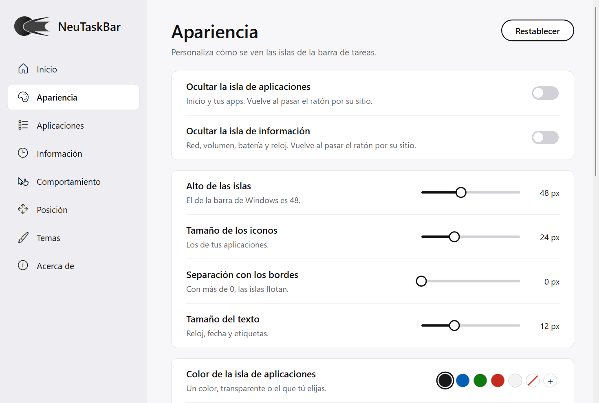

<div align="center">

# NeuTaskBar

**La barra de tareas de Windows, convertida en dos islas.**


</div>

```text
┌──────────────────────────────── tu pantalla ────────────────────────────────┐
│                                                                             │
│ ╭───────────────────────────────╮                  ╭──────────────────────╮ │
│ │ Inicio │ tus apps, una a una  │                  │ red  vol  bat  hora  │ │
└─┴───────────────────────────────┴──────────────────┴──────────────────────┴─┘
        isla de aplicaciones                           isla de información
```

## ✨ Qué hace

| | |
| --- | --- |
| 🏝️ **Dos islas** | Tus aplicaciones a un lado; red, volumen, batería y reloj al otro. Entre las dos, el escritorio o la ventana que tengas maximizada. |
| 🎨 **Colores** | Cada isla con su color: predefinido, el que elijas o transparente. |
| 🧩 **A tu medida** | Tamaño, opacidad, contorno, color de énfasis, qué muestra cada isla, formato del reloj y cómo responde al ratón. |
| 🖼️ **Temas** | Aspectos ya hechos, y tus ajustes en un archivo para llevarlos a otro equipo. |
| 🙈 **Ocultar** | Esconde una isla, la otra o las dos hasta pasar el ratón por su sitio. |
| 📍 **Mover y unir** | Lleva cada isla a la esquina que quieras, también arriba; la de aplicaciones, además al centro. O únelas en una sola barra. |
| ➖ **Barra completa** | Si prefieres lo clásico: una sola barra de lado a lado, como la de Windows, con todo lo demás igual. |
| 📁 **Grupos** | Reúne hasta cuatro apps en un solo botón, desde el clic derecho de cualquiera de ellas. |
| 🌍 **Idiomas** | Español, inglés y francés. |
| 🔄 **Sigue a Windows** | Respeta la posición, el tamaño, la alineación y los botones que elijas en la configuración de Windows. |
| 🛟 **Sin riesgo** | La barra original no se toca: vuelve al desactivar, al salir o si algo falla. |

## 🚀 Empezar

No hay instalador ni hace falta instalar nada más.

1. **Descarga** el proyecto: botón verde **Code ▸ Download ZIP**, y descomprímelo donde quieras.
2. **Genera el programa**: clic derecho sobre `build.ps1` ▸ **Ejecutar con PowerShell**. Tarda unos segundos y crea `NeuTaskBar.exe`.
3. **Ábrelo** y pulsa **Activar barra de tareas**.

¿Prefieres la terminal? Abre PowerShell en la carpeta del proyecto y ejecuta:

```powershell
powershell -ExecutionPolicy Bypass -File build.ps1 -Run
```

Compila, añade la aplicación al menú Inicio y a Configuración ▸ Aplicaciones, y la abre: solo queda pulsar **Activar barra de tareas**.

> [!TIP]
> Cerrar la ventana no apaga la barra. Para volver a la de Windows, pulsa **Desactivar barra de tareas**. Después puedes abrir la aplicación desde el menú Inicio escribiendo "NeuTaskBar".

## 🎛️ Personalizar

Todo se cambia desde la ventana de la aplicación y se aplica al momento, sin reiniciar la barra.

<div align="center">

</div>

| Página | Qué puedes hacer |
| --- | --- |
| **Inicio** | Activar o desactivar la barra · iniciar con Windows · idioma |
| **Apariencia** | Ocultar cada isla · alto, tamaño de los iconos, separación con los bordes y tamaño del texto · color y opacidad de cada isla, o seguir el modo claro u oscuro de Windows · relleno del hueco entre las islas · color de énfasis · contorno · animaciones |
| **Aplicaciones** | Marca de app abierta (línea, punto o ninguna; una por ventana, hasta cuatro) · efecto al pasar el ratón · separación entre iconos · iconos en gris · rebote al abrir · quitar el botón de Inicio · anchura mínima · apps ocultas · deshacer los grupos |
| **Información** | Mostrar u ocultar red, volumen y batería · porcentaje de batería · hora en 24 o 12 horas · fecha corta, con día de la semana o sin fecha · uso de procesador y memoria · controles multimedia · avisos de volumen y batería |
| **Comportamiento** | Clic central (nueva ventana o cerrar) · rueda sobre una app (cambiar de ventana) · vistas previas · espera antes de esconderse |
| **Posición** | **Barra completa** de lado a lado, en vez de dos islas · **Unir** las islas · **Mover**: arrástralas a una esquina libre (la de aplicaciones, también al centro de arriba o de abajo) y pulsa **Confirmar** · volver a su sitio |
| **Temas** | Clásico, Claro, Cristal, Compacto y Flotante · exportar e importar los ajustes · restablecerlo todo |
| **Acerca de** | Repositorio · carpeta de instalación · desinstalar |

De **Apariencia** a **Posición**, cada página tiene arriba a la derecha un botón **Restablecer**: devuelve sus ajustes a como vienen de fábrica, después de preguntar.

## 🖱️ Usar la barra

| Acción | Resultado |
| --- | --- |
| Clic en un icono | Abre la app, o la trae al frente / la minimiza |
| Clic central | Abre otra ventana de esa app (o la cierra, si lo eliges en Comportamiento) |
| Rueda sobre una app abierta | Pasa de una ventana suya a otra (si lo activas en Comportamiento) |
| Clic derecho | Menú: accesos de la app, anclar o desanclar, crear un grupo o añadirla a uno, ocultar de la barra, cerrar |
| Clic en un grupo | Despliega sus apps, para abrir o traer al frente la que elijas |
| Clic derecho en un grupo | Sacar una app, deshacer el grupo o cerrar sus ventanas |
| Arrastrar un icono | Cambia el orden |
| Arrastrar un `.exe` o `.lnk` a la isla | Lo ancla |
| Pasar el ratón por una app abierta | Vista previa de sus ventanas |
| Clic en red, volumen o batería | Configuración rápida (la rueda cambia el volumen) |
| Clic en el reloj | Calendario y notificaciones |
| Clic en el uso de procesador o memoria | Administrador de tareas |
| Clic en un control multimedia | Anterior, reproducir o pausar, siguiente |
| Clic en la flecha `^` | Iconos ocultos de la bandeja |

Bajo cada app abierta hay una marca por ventana, hasta cuatro; la de la app que tienes delante va en el color de énfasis.

Un **grupo** es un botón con hasta cuatro apps, que se ven dentro en miniatura. Se crea con clic derecho en una app ▸ **Crear grupo**, y las demás se suman con clic derecho ▸ **Añadir al grupo**. Las apps de un grupo quedan ancladas, y el grupo se arrastra como cualquier otro icono. El botón de un grupo no lleva marcas debajo.

## 🗑️ Desinstalar

Desde **Acerca de ▸ Desinstalar**, desde Configuración ▸ Aplicaciones o ejecutando `Uninstall.exe`. Devuelve la barra de Windows y te pregunta si quieres conservar tus ajustes.

## 🛠️ Para desarrolladores

C# sobre .NET Framework 4.x y Win32 puro, sin dependencias: se compila con el `csc.exe` que ya trae Windows.

<details>
<summary><b>Compilar</b></summary>

```powershell
.\build.ps1          # genera NeuTaskBar.exe y Uninstall.exe en esta carpeta
.\build.ps1 -Run     # compila y abre la aplicación
```

- Si PowerShell bloquea el script: `powershell -ExecutionPolicy Bypass -File build.ps1`.
- Con la barra en marcha el `.exe` está en uso: ciérrala antes con `NeuTaskBar.exe --quit`.
- El icono y la imagen de la ventana se generan a partir de `assets\logo-source.png`.

</details>

<details>
<summary><b>Estructura del proyecto</b></summary>

| Ruta | Contenido |
| --- | --- |
| `src/Program.cs` | Arranque y modos de ejecución |
| `src/App.cs` | Motor de la barra: reparto de las islas, ocultación, menús |
| `src/Island.cs`, `LeftIsland.cs`, `RightIsland.cs` | Las islas: ventana, pintado y ratón |
| `src/Apps.cs` | Apps ancladas, grupos, ventanas abiertas y sus iconos |
| `src/TaskbarMenu.cs`, `Flyout.cs`, `JumpList.cs` | Menús de la barra, vistas previas de ventanas y listas de salto |
| `src/SystemInfo.cs` | Volumen, red, batería y uso del equipo |
| `src/SettingsForm.cs`, `Ui.cs` | Ventana de la aplicación y sus controles |
| `src/Config.cs` | Ajustes (`config.ini` y registro de Windows) |
| `src/Lang.cs` | Textos en los tres idiomas |
| `src/ShellTaskbar.cs`, `StripFill.cs` | Barra original de Windows y franja reservada |
| `src/Gfx.cs`, `GfxText.cs`, `Gdi.cs`, `Native.cs` | Dibujo y llamadas a Windows |
| `uninstall/` | Desinstalador |
| `docs/` | Capturas de este documento |

El motor (`--engine`) y la ventana son procesos distintos: la ventana guarda en `config.ini` y avisa al motor, que lo aplica sin reiniciar. Un tercer proceso (`--guard`) repone la barra de Windows si el motor muere.

</details>

<details>
<summary><b>Línea de comandos</b></summary>

| Orden | Efecto |
| --- | --- |
| `NeuTaskBar.exe` | Abre la ventana |
| `NeuTaskBar.exe --engine` | Inicia la barra sin ventana |
| `NeuTaskBar.exe --quit` | Cierra la barra |
| `NeuTaskBar.exe --restore` | Recupera la barra de Windows si quedó oculta |
| `NeuTaskBar.exe --autostart on\|off` | Inicio con Windows |
| `Uninstall.exe --silent` | Desinstala sin preguntar |

</details>

<details>
<summary><b>Ajustes en <code>config.ini</code></b></summary>

`%APPDATA%\NeuTaskBar\config.ini`, una `clave=valor` por línea. La ventana las escribe todas menos `tint`. Una clave que falta vale lo que se indica entre paréntesis.

| Clave | Valores |
| --- | --- |
| `lang` | `es`, `en`, `fr` (sin ella, el idioma de Windows) |
| `hideleft`, `hideright` | `1` esconde la isla de aplicaciones / de información |
| `tintleft`, `tintright` | Color `AARRGGBB` de cada isla (alfa `00` = transparente) |
| `tint` | Color común, si no se elige uno por isla (`8C1A1A1A`) |
| `opacity` | Opacidad del color de las dos islas, de `0` a `100` (vacío = la de cada color) |
| `autotheme` | `1` = islas claras u oscuras según el modo de Windows, en vez de sus colores |
| `fill` | Hueco entre las islas bajo una ventana maximizada: `0` continúa la ventana, `1` color de las islas |
| `accent`, `accentwin` | Color de énfasis `RRGGBB` (vacío = azul) · `1` usa el de Windows |
| `ink` | Color del contenido: `0` automático, `1` claro, `2` oscuro |
| `border` | `1` dibuja un contorno fino |
| `height`, `iconsize` | Alto de las islas y tamaño de icono a 96 dpi (`48` y `24`) |
| `margin` | Separación con los bordes de la pantalla (`0`) |
| `textsize` | Tamaño del texto, de `10` a `16` (`12`) |
| `reducemotion`, `calmonbattery` | `1` quita las animaciones siempre / solo con batería |
| `fullbar` | `1` = barra completa de lado a lado en vez de dos islas (manda sobre `join` y las esquinas) |
| `join` | `1` une las islas |
| `cornerleft`, `cornerright` | Esquina de cada isla: `tl`, `tr`, `bl`, `br` (vacío = donde manda Windows). `cornerleft` admite además el centro: `tc` arriba, `bc` abajo |
| `indicator` | Marca de app abierta: `0` línea, `1` punto, `2` ninguna |
| `hover` | Al pasar el ratón: `0` resalta, `1` amplía el icono, `2` nada |
| `icongap` | Separación entre iconos, de `0` a `16` (`2`) |
| `mono`, `bounce` | `1` iconos en gris · `0` quita el rebote al abrir una app |
| `hidestart`, `minwidth` | `1` quita el botón de Inicio · anchura mínima de la isla de aplicaciones (`0`) |
| `hideapps` | Apps que no se muestran, separadas por `;` (nombre del exe o su AppUserModelID) |
| `shownet`, `showvol`, `showbat` | `0` quita el icono de red, volumen o batería |
| `batpercent` | `1` añade el porcentaje de batería |
| `clocktime`, `clockdate` | Hora: `0` la de Windows, `1` 24 h, `2` 12 h · fecha: `0` corta, `1` con día de la semana, `2` sin fecha |
| `showcpu`, `showram`, `showmedia` | `1` muestra el uso de procesador, el de memoria o los controles multimedia |
| `notices` | `1` enseña un momento el volumen o la batería en el sitio del reloj cuando cambian |
| `middleclick`, `wheel` | Clic central: `0` nueva ventana, `1` cerrar · rueda sobre una app: `1` cambia de ventana |
| `previews`, `hidedelay` | `0` quita las vistas previas · milisegundos antes de esconderse una isla oculta (`450`) |

Las apps ancladas se guardan en `pins.txt`, en la misma carpeta, y los grupos en `groups.txt` (uno por línea, con las rutas de sus apps separadas por `|`).

</details>

<details>
<summary><b>Añadir un idioma o una opción</b></summary>

- **Idioma**: en `src/Lang.cs`, una entrada más en `Codes` y `Names` y una columna más en cada fila de la tabla. El código pide cada texto con `L.T("texto en español")`.
- **Opción**: cada página es una clase `Page` de `src/SettingsForm.cs`, hecha con `Card` y `SettingRow` más un control (`ToggleSwitch`, `PillButton`, `SegmentedPicker`, `SwatchPicker`, `Slider`). Lo más corto es `Opt.Toggle`, `Opt.Choice` u `Opt.Range`, que ya guardan la clave y avisan al motor; la clave se lee en `Config.Load` y, si forma parte del aspecto, se añade a `LookKeys` para que entre en los temas.

</details>

<details>
<summary><b>Contribuir</b></summary>

- El formato lo fijan `.editorconfig` y `.gitattributes`.
- No se suben ejecutables ni archivos generados (`.gitignore`); las versiones se publican como Release.
- Un cambio por commit, y una línea en [`CHANGELOG.md`](CHANGELOG.md) si lo nota el usuario.
- `.\build.ps1` debe compilar sin avisos.

</details>

## ⚠️ Limitaciones

- Solo sustituye la barra del monitor principal.
- Inicio, la configuración rápida y el calendario salen por donde Windows tiene su barra, aunque muevas las islas.
- Los iconos de bandeja de otros programas no se dibujan en la isla: están en la flecha `^`.
- El hueco entre las islas toma el color de la ventana maximizada, pero la app no dibuja ni recibe clics ahí. Si la ventana acaba en un fondo dibujado o en texto, cada panel se continúa con su color liso; si acaba en una imagen, con un solo color.
- Unidas o en la barra completa, las islas llevan un solo color, el de la isla de aplicaciones.
- La barra completa va en el borde de la barra de Windows y no se mueve; las esquinas elegidas se recuperan al volver a las islas.
- Los grupos no tienen nombre ni vista previa: al pasar el ratón enseñan los nombres de sus apps.
- Los controles multimedia envían las teclas de anterior, reproducir o pausar y siguiente: no muestran qué suena ni si está en pausa.
- En barras verticales la hora de 12 horas va sin AM ni PM, para que quepa.

## 📄 Licencia

[CC0 1.0 Universal](LICENSE): dominio público, sin condiciones.
