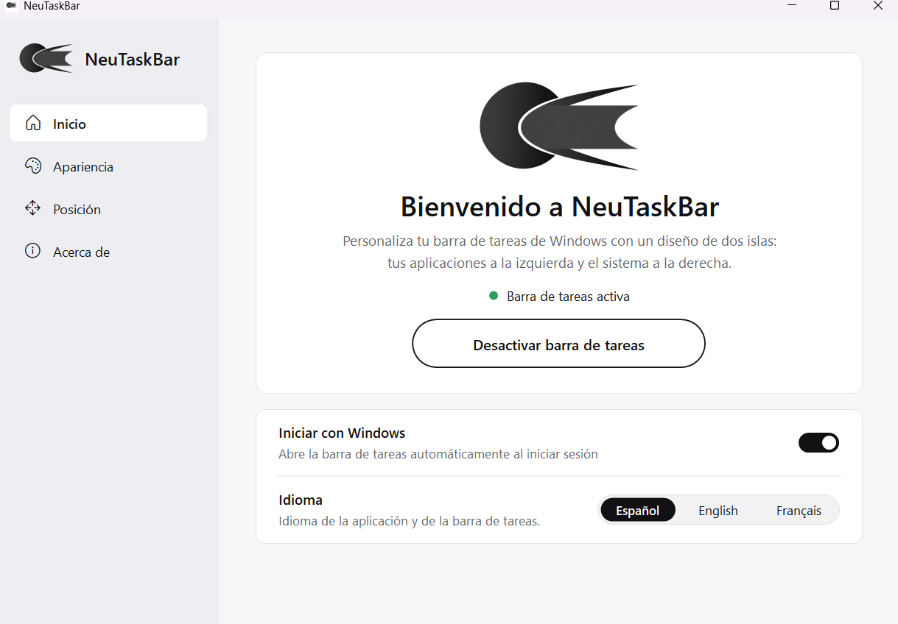

<div align="center">

# NeuTaskBar

**La barra de tareas de Windows, convertida en dos islas.**




</div>

```text
┌──────────────────────────────── tu pantalla ────────────────────────────────┐
│                                                                             │
│ ╭───────────────────────────────╮                  ╭──────────────────────╮ │
│ │ Inicio │ tus apps, una a una  │                  │ red  vol  bat  hora  │ │
└─┴───────────────────────────────┴──────────────────┴──────────────────────┴─┘
        isla de aplicaciones                           isla de información
```

## ✨ Qué hace

| | |
| --- | --- |
| 🏝️ **Dos islas** | Tus aplicaciones a un lado; red, volumen, batería y reloj al otro. |
| 🎨 **Colores** | Cada isla con su color: predefinido, el que elijas o transparente. |
| 🙈 **Ocultar** | Esconde una isla, la otra o las dos hasta pasar el ratón por su sitio. |
| 📍 **Mover y unir** | Lleva cada isla a la esquina que quieras, también arriba, o únelas en una sola barra. |
| 🌍 **Idiomas** | Español, inglés y francés. |
| 🔄 **Sigue a Windows** | Respeta la posición, el tamaño, la alineación y los botones que elijas en la configuración de Windows. |
| 🛟 **Sin riesgo** | La barra original no se toca: vuelve al desactivar, al salir o si algo falla. |

## 🚀 Empezar

No hay instalador ni hace falta instalar nada más.

1. **Descarga** el proyecto: botón verde **Code ▸ Download ZIP**, y descomprímelo donde quieras.
2. **Genera el programa**: clic derecho sobre `build.ps1` ▸ **Ejecutar con PowerShell**. Tarda unos segundos y crea `NeuTaskBar.exe`.
3. **Ábrelo** y pulsa **Activar barra de tareas**.

> [!TIP]
> Cerrar la ventana no apaga la barra. Para volver a la de Windows, pulsa **Desactivar barra de tareas**. Después puedes abrir la aplicación desde el menú Inicio escribiendo "NeuTaskBar".

## 🎛️ Personalizar

| Página | Qué puedes hacer |
| --- | --- |
| **Inicio** | Activar o desactivar la barra · iniciar con Windows · idioma |
| **Apariencia** | Ocultar cada isla · color de cada isla |
| **Posición** | **Unir** las islas · **Mover**: arrástralas a una esquina libre y pulsa **Confirmar** · **Restablecer** |
| **Acerca de** | Repositorio · carpeta de instalación · desinstalar |

## 🖱️ Usar la barra

| Acción | Resultado |
| --- | --- |
| Clic en un icono | Abre la app, o la trae al frente / la minimiza |
| Clic central | Abre otra ventana de esa app |
| Clic derecho | Menú: accesos de la app, anclar o desanclar, cerrar |
| Arrastrar un icono | Cambia el orden |
| Arrastrar un `.exe` o `.lnk` a la isla | Lo ancla |
| Pasar el ratón por una app abierta | Vista previa de sus ventanas |
| Clic en red, volumen o batería | Configuración rápida (la rueda cambia el volumen) |
| Clic en el reloj | Calendario y notificaciones |
| Clic en la flecha `^` | Iconos ocultos de la bandeja |

## 🗑️ Desinstalar

Desde **Acerca de ▸ Desinstalar**, desde Configuración ▸ Aplicaciones o ejecutando `Uninstall.exe`. Devuelve la barra de Windows y te pregunta si quieres conservar tus ajustes.

## 🛠️ Para desarrolladores

C# sobre .NET Framework 4.x y Win32 puro, sin dependencias: se compila con el `csc.exe` que ya trae Windows.

<details>
<summary><b>Compilar</b></summary>

```powershell
.\build.ps1          # genera NeuTaskBar.exe y Uninstall.exe en esta carpeta
.\build.ps1 -Run     # compila y abre la aplicación
```

- Si PowerShell bloquea el script: `powershell -ExecutionPolicy Bypass -File build.ps1`.
- Con la barra en marcha el `.exe` está en uso: ciérrala antes con `NeuTaskBar.exe --quit`.
- El icono y la imagen de la ventana se generan a partir de `assets\logo-source.png`.

</details>

<details>
<summary><b>Estructura del proyecto</b></summary>

| Ruta | Contenido |
| --- | --- |
| `src/Program.cs` | Arranque y modos de ejecución |
| `src/App.cs` | Motor de la barra: reparto de las islas, ocultación, menús |
| `src/Island.cs`, `LeftIsland.cs`, `RightIsland.cs` | Las islas: ventana, pintado y ratón |
| `src/SettingsForm.cs`, `Ui.cs` | Ventana de la aplicación y sus controles |
| `src/Config.cs` | Ajustes (`config.ini` y registro de Windows) |
| `src/Lang.cs` | Textos en los tres idiomas |
| `src/ShellTaskbar.cs`, `StripFill.cs` | Barra original de Windows y franja reservada |
| `uninstall/` | Desinstalador |

El motor (`--engine`) y la ventana son procesos distintos: la ventana guarda en `config.ini` y avisa al motor, que lo aplica sin reiniciar. Un tercer proceso (`--guard`) repone la barra de Windows si el motor muere.

</details>

<details>
<summary><b>Línea de comandos</b></summary>

| Orden | Efecto |
| --- | --- |
| `NeuTaskBar.exe` | Abre la ventana |
| `NeuTaskBar.exe --engine` | Inicia la barra sin ventana |
| `NeuTaskBar.exe --quit` | Cierra la barra |
| `NeuTaskBar.exe --restore` | Recupera la barra de Windows si quedó oculta |
| `NeuTaskBar.exe --autostart on\|off` | Inicio con Windows |
| `Uninstall.exe --silent` | Desinstala sin preguntar |

</details>

<details>
<summary><b>Ajustes en <code>config.ini</code></b></summary>

`%APPDATA%\NeuTaskBar\config.ini`, una `clave=valor` por línea. La ventana escribe casi todas; las cuatro últimas solo se cambian a mano.

| Clave | Valores |
| --- | --- |
| `lang` | `es`, `en`, `fr` (sin ella, el idioma de Windows) |
| `hideleft`, `hideright` | `1` esconde la isla de aplicaciones / de información |
| `tintleft`, `tintright` | Color `AARRGGBB` de cada isla (alfa `00` = transparente) |
| `join` | `1` une las islas |
| `cornerleft`, `cornerright` | Esquina de cada isla: `tl`, `tr`, `bl`, `br` (vacío = donde manda Windows) |
| `tint` | Color común, si no se elige uno por isla (`8C1A1A1A`) |
| `height`, `iconsize` | Alto de las islas y tamaño de icono a 96 dpi (`48` y `24`) |
| `margin` | Separación con los bordes de la pantalla (`0`) |

Las apps ancladas se guardan en `pins.txt`, en la misma carpeta.

</details>

<details>
<summary><b>Añadir un idioma o una opción</b></summary>

- **Idioma**: en `src/Lang.cs`, una entrada más en `Codes` y `Names` y una columna más en cada fila de la tabla. El código pide cada texto con `L.T("texto en español")`.
- **Opción**: cada página es una clase `Page` de `src/SettingsForm.cs`, hecha con `Card` y `SettingRow` más un control (`ToggleSwitch`, `PillButton`, `SegmentedPicker`, `SwatchPicker`). Guarda con `Config.Save` y avisa al motor con `Engine.ReloadConfig`.

</details>

<details>
<summary><b>Contribuir</b></summary>

- El formato lo fijan `.editorconfig` y `.gitattributes`.
- No se suben ejecutables ni archivos generados (`.gitignore`); las versiones se publican como Release.
- Un cambio por commit, y una línea en [`CHANGELOG.md`](CHANGELOG.md) si lo nota el usuario.
- `.\build.ps1` debe compilar sin avisos.

</details>

## ⚠️ Limitaciones

- Solo sustituye la barra del monitor principal.
- Inicio, la configuración rápida y el calendario salen por donde Windows tiene su barra, aunque muevas las islas.
- Los iconos de bandeja de otros programas no se dibujan en la isla: están en la flecha `^`.
- El hueco entre las islas toma el color de la ventana maximizada, pero la app no dibuja ni recibe clics ahí.
- Unidas, las islas llevan un solo color, el de la isla de aplicaciones.

## 📄 Licencia

[CC0 1.0 Universal](LICENSE): dominio público, sin condiciones.
